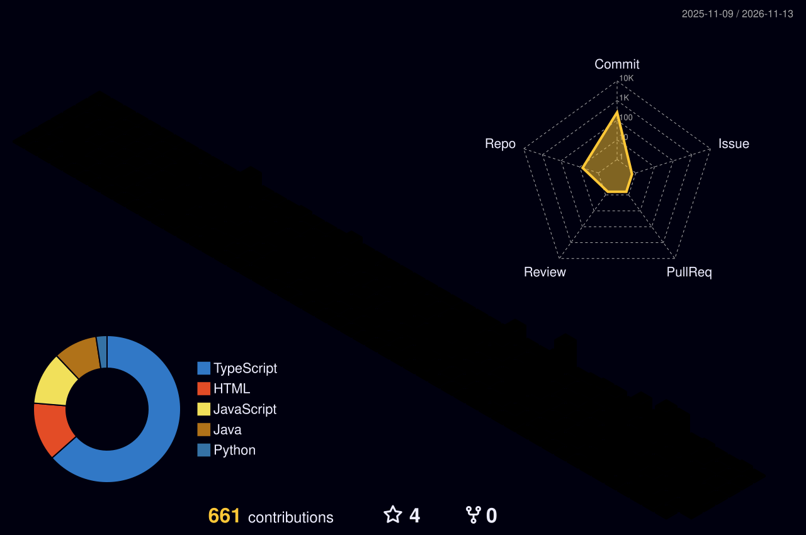

<!--
  Ali Azam Kazmi — Product Engineer (fleet, telematics & geospatial products), New Delhi, India.
  Next.js · React · Angular · TypeScript · Three.js · D3.js · UX / product design · PRDs.
-->

<a href="https://aliazamkazmi.vercel.app/">
  
</a>

<h3 align="center">Product Engineer · Fleet, Telematics &amp; Geospatial Products · moving into Technical PM</h3>

<p align="center">
  <a href="https://aliazamkazmi.vercel.app/"></a>
</p>
<p align="center">
  <a href="https://www.linkedin.com/in/ali-azam-kazmi/"></a>
  <a href="mailto:aliazamkazmi1291@gmail.com"></a>
  <a href="https://www.behance.net/aliak8"></a>
  <a href="https://www.figma.com/@aliak"></a>
  <a href="https://medium.com/@aliazamkazmi1291"></a>
  <a href="https://www.dumbmoney.in/"></a>
</p>

<p align="center"></p>

## 👋 About me

I'm a **product-minded engineer**: I write the PRD, design the UX in Figma, build the frontend, and work with backend, QA and business teams until it ships. Since Sep 2024 I've been doing that on **enterprise fleet-management, vehicle-tracking and telematics platforms** at MapmyIndia (Gtropy).

<p align="center">
  
</p>

<details>
<summary><b>🛰️ Production work at MapmyIndia — click to expand</b></summary>
<br/>

| Product | What I did | Scale |
|---|---|---|
| **Vahan Shakti** | Vehicle tracking & analytics. React map components: live location, clustering, heatmaps, route plotting | 200,000+ users |
| **[Mappls Intouch](https://play.google.com/store/apps/details?id=intouch.mappls.app)** | Cross-platform logistics & fleet app. Built Driver Safety (DMS, ADAS, scorecards) for clients VinFast and SM Green | 10,000+ active vehicles |
| **[Indane Yatra Mitra (IOCL)](https://play.google.com/store/apps/details?id=iocl.cvtms.mappls)** | LPG tanker fleet tracking: safety alarms, geofencing, route playback, role-based access | Live on Play Store |
| **Mappls Shop** | Subscription renewal & billing admin (Angular, Razorpay, Odoo) | 4× collections |
| **Locate** | Manufacturer backend for real-time vehicle monitoring. I led the frontend on my own | 20,000+ vehicles |
| **Control Tower** | Real-time alert management, ticketing and map-based trip analysis | Enterprise |

<sub>Most of this code is in private company repositories. The case studies are on my <a href="https://aliazamkazmi.vercel.app/missions">portfolio</a>.</sub>

</details>

<details>
<summary><b>🧭 How I work</b></summary>
<br/>

```text
PROBLEM → UNDERSTAND → STRATEGY → UX → TECHNOLOGY → BUILD → SHIP → LEARN → NEXT PROBLEM
```

- 📐 **Product:** PRDs, user stories, acceptance criteria, edge cases, roadmaps, prioritisation
- 🎨 **Design:** Figma, Spline and Adobe Suite. I run [Smaak.ux](https://www.behance.net/aliak8), a product and brand studio (10+ clients across SaaS, FMCG, interiors and Web3)
- ⚙️ **Build:** Next.js, React, Angular, React Native, Three.js, D3.js
- 🤖 **AI:** Claude, Gemini and ChatGPT for research and AI-assisted development
- 🎓 B.Tech Computer Science, **SRM Institute of Science and Technology**

> *"A jack of all trades is a master of none, but oftentimes better than a master of one."*

</details>

<p align="center"></p>

## 🚀 Featured projects

<table>
  <tr>
    <td width="50%"><a href="https://github.com/aliazam1291/sapceos"></a></td>
    <td width="50%"><a href="https://github.com/aliazam1291/D3-Advance-Visuals"></a></td>
  </tr>
  <tr>
    <td width="50%"><a href="https://github.com/aliazam1291/sundar"></a></td>
    <td width="50%"><a href="https://github.com/aliazam1291/casa"></a></td>
  </tr>
  <tr>
    <td width="50%"><a href="https://github.com/aliazam1291/react-tech-loaders"></a></td>
    <td width="50%"><a href="https://github.com/aliazam1291/Honeypot-ssh"></a></td>
  </tr>
</table>

<details>
<summary><b>📂 All projects, with descriptions and stacks</b></summary>
<br/>

| Project | Description | Stack |
|---|---|---|
| 🌌 **[SPACE OS](https://github.com/aliazam1291/sapceos)** · [live](https://aliazamkazmi.vercel.app/) | My portfolio, built as a 3D flight through a galaxy: projects are missions, case studies are drones. Before each release, Playwright harnesses check SEO, Lighthouse and mobile | Next.js 16, React 19, Three.js, R3F, GSAP, Lenis, Supabase |
| 📊 **[D3 Advanced Visuals](https://github.com/aliazam1291/D3-Advance-Visuals)** | A D3 + Next.js visualization engine for analytics and operations dashboards. Reusable, themeable chart components with a dark and a light theme | D3.js, Next.js, TypeScript, Zustand |
| 🌶️ **[Sunder Masala](https://github.com/aliazam1291/sundar)** | Rebrand website for a heritage spice brand (est. 1975): a 32-SKU catalogue in three product ranges, statically generated product pages, a regional map and the brand story | Next.js 16, Tailwind CSS v4 |
| 🛋️ **[Wolf Casa](https://github.com/aliazam1291/casa)** | Website for a premium interiors showroom with 3D curated rooms and physics-based interactions | Next.js, React Three Fiber, Rapier, GSAP, Radix UI |
| 💍 **[Happy Weddings](https://github.com/aliazam1291/Happy-weddings-hue-cycle-v2)** | Website for a wedding-planning studio: parallax storytelling, project galleries, a blog, an Instagram feed, sitemap and robots.txt | Next.js, Framer Motion, GSAP, Lenis, Radix UI |
| 🎙️ **[KU](https://github.com/aliazam1291/KU)** | Website for a talk-show and podcast community: featured shows, episodes and a hosts carousel, with a custom cursor | Next.js, TypeScript, Three.js, Framer Motion |
| ⏳ **[React Tech Loaders](https://github.com/aliazam1291/react-tech-loaders)** | Futuristic React loading screens: hacker terminal, pixel world and neon circular loaders | React, TypeScript |
| 💹 **[Crypto Dashboard](https://github.com/aliazam1291/Crypto-Dashboard)** · [Figma](https://www.figma.com/community/file/1618234851830942940/futuristic-crypto-dashboard) | A futuristic crypto-trading dashboard, from Figma design to code | React, Vite, Tailwind CSS, MUI, Radix UI |
| 🔐 **[SSH Honeypot](https://github.com/aliazam1291/Honeypot-ssh)** | A Dockerised SSH honeypot that simulates a shell and logs attacker commands | Python, Paramiko, Docker |
| 🔁 **[Telegram → Discord Bot](https://github.com/aliazam1291/Telegram-To-Discord-Forward-Bot)** | Forwards messages from Telegram channels to Discord in real time | Python, Telethon, Discord |

</details>

<details>
<summary><b>🧠 AI / ML &amp; computer-vision projects</b></summary>

| Project | Description |
|---|---|
| **[PUJ Obstruction Detection](https://github.com/aliazam1291/Pelvic-Uretero-Pelvic-Obstruction-Using-Deep-Learning)** | Deep learning on ultrasound images to classify pelvi-ureteric junction (PUJ) obstruction. Transfer learning with VGG16, InceptionV3 and DenseNet121; research paper included |
| **[Handwritten Text Recognition](https://github.com/aliazam1291/Dectect-handwritten-text)** | OCR pipeline with OpenCV preprocessing and Tesseract |
| **[Multilingual Text Inversion](https://github.com/aliazam1291/multi-lingual-text-inversion)** | Detects whether text in an image is upside down, across multiple scripts such as English and Greek (VGG16, contour bounding boxes) |
| **[Stock Market Prediction](https://github.com/aliazam1291/Stock-market-prediction)** | Keras stock-price prediction model served through a Flask API (Alpha Vantage data) with a React frontend |
| **[Image Augmentation](https://github.com/aliazam1291/Image-Augmentation)** | Image augmentation with imgaug to expand medical-imaging training datasets |
| **[Artificial Intelligence](https://github.com/aliazam1291/Artificial-Intelligence)** | Classic AI algorithms: BFS/DFS, CSP, graph colouring, unification, water jug, ANN, sentiment analysis |

</details>

<details>
<summary><b>🕹️ Earlier builds</b></summary>

[Carbon Footprint Calculator](https://github.com/aliazam1291/Carbon-footprint-calculator) · [Weather Forecast](https://github.com/aliazam1291/Weather-forcast) · [Excel Management App](https://github.com/aliazam1291/Excel-Management-Application) · [NASA Website Revamp](https://github.com/aliazam1291/Nasa-Revamp) · [Space Invaders](https://github.com/aliazam1291/Space_invasion) · [Flappy Bird](https://github.com/aliazam1291/Flappy-bird) · [LeetCode solutions](https://github.com/aliazam1291/Leetcode)

</details>

<p align="center"></p>

## 🛠️ Tech stack

<p align="center">
  
</p>

<p align="center"><sub>Also: React Native · Ionic · RxJS · D3.js · GSAP · Mappls SDK · OpenCV · TensorFlow · Supabase · Playwright</sub></p>

<p align="center"></p>

## 🧊 Contributions in 3D

<p align="center">
  
</p>
<p align="center">
  
</p>

<picture>
  <source media="(prefers-color-scheme: dark)" srcset="https://raw.githubusercontent.com/aliazam1291/aliazam1291/output/github-contribution-grid-snake-dark.svg" />
  
</picture>

<details>
<summary><b>⚡ Recent activity</b></summary>
<br/>

<!--START_SECTION:activity-->
<!--END_SECTION:activity-->

</details>

<p align="center"></p>

<p align="center">
  <b>Open to Product Manager / Technical PM roles. Based in New Delhi, open to relocate.</b><br/>
  <a href="https://aliazamkazmi.vercel.app/contact">Contact me</a> · <a href="https://aliazamkazmi.vercel.app/Ali_Azam_Kazmi_.pdf">Résumé</a> · <a href="https://aliazamkazmi.vercel.app/missions">Case studies</a>
</p>

<p align="center">
  
</p>
