<!--
  Ali Azam Kazmi — Product Engineer moving into Technical PM. Fleet, telematics & geospatial products at MapmyIndia (Mappls).
  Founder & CPO of DumbMoney. Smaak.ux design studio. New Delhi, India.
  Product management · PRDs · UX design · Figma · Next.js · React · Angular · Three.js · D3.js
-->

<a href="https://aliazamkazmi.vercel.app">
  
</a>

  <b>Product Engineer → Technical PM</b> · I write the PRD, design it in Figma, build it, and ship it. 
  Fleet, telematics &amp; geospatial products at <b>MapmyIndia (Mappls)</b> · Founder &amp; CPO, <b>DumbMoney</b> · <b>Smaak.ux</b> design studio · New Delhi, India

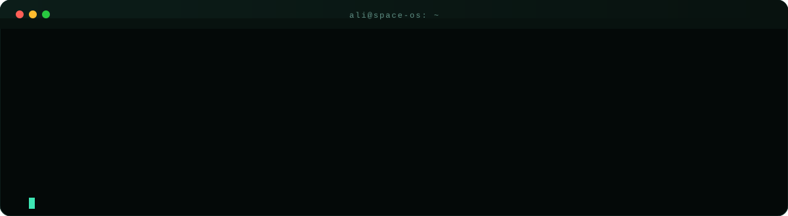

<table>
<tr>
<td width="25%"><a href="https://aliazamkazmi.vercel.app"></a></td>
<td width="25%"></td>
<td width="25%"><a href="https://www.behance.net/aliak8"></a></td>
<td width="25%"><a href="https://www.figma.com/@aliak"></a></td>
</tr>
<tr>
<td width="25%"><a href="https://aliazamkazmi.vercel.app/Ali_Azam_Kazmi_.pdf"></a></td>
<td width="25%"></td>
<td width="25%"></td>
<td width="25%"></td>
</tr>
</table>

<a href="https://aliazamkazmi.vercel.app/missions">
  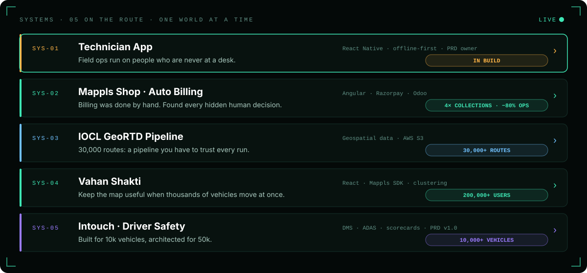
</a>

<b>🛰️ Mission reports: what I owned on each product</b>

 

| Product | What I did | Scale |
|---|---|---|
| **Vahan Shakti** | Vehicle tracking & analytics. React map components: live location, clustering, heatmaps, route plotting | 200,000+ users |
| **[Mappls Intouch](https://play.google.com/store/apps/details?id=intouch.mappls.app)** | Cross-platform logistics & fleet app. Built Driver Safety (DMS, ADAS, scorecards) for clients VinFast and SM Green | 10,000+ active vehicles |
| **[Indane Yatra Mitra (IOCL)](https://play.google.com/store/apps/details?id=iocl.cvtms.mappls)** | LPG tanker fleet tracking: safety alarms, geofencing, route playback, role-based access | Live on Play Store |
| **Mappls Shop** | Subscription renewal & billing admin (Angular, Razorpay, Odoo) | 4× collections |
| **Locate** | Manufacturer backend for real-time vehicle monitoring. I led the frontend on my own | 20,000+ vehicles |
| **Control Tower** | Real-time alert management, ticketing and map-based trip analysis | Enterprise |

Most of this code is in private company repositories. The case studies are on my <a href="https://aliazamkazmi.vercel.app/missions">portfolio</a>.

**On every product I own:** the PRD (problem, user stories, acceptance criteria, edge cases) · UX in Figma · frontend implementation · coordination with backend, QA, ops and business.

- **Mappls Shop.** Replaced manual subscription renewals with self-service renewal, Razorpay payments and Odoo invoicing. Result: **4× the collections** and **80% less manual ops work**.
- **Intouch Driver Safety.** I own the PRD v1.0: DMS (in-cab alarms), ADAS (road-facing alarms), driver scorecards and alert settings. It's built driver-first: one screen to find who needs attention.
- **Vahan Shakti / Locate.** I defined the vehicle-status logic (moving, stopped, idle, delayed, offline) and the map UX (route playback, fit-to-route, clustering), and improved performance on data-heavy dashboards by about 40% (caching, RxJS state, API optimisation).


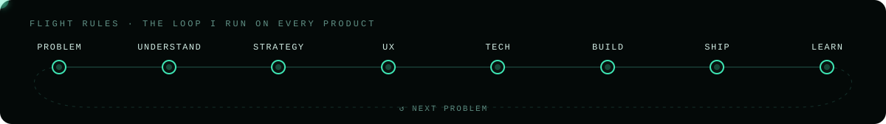

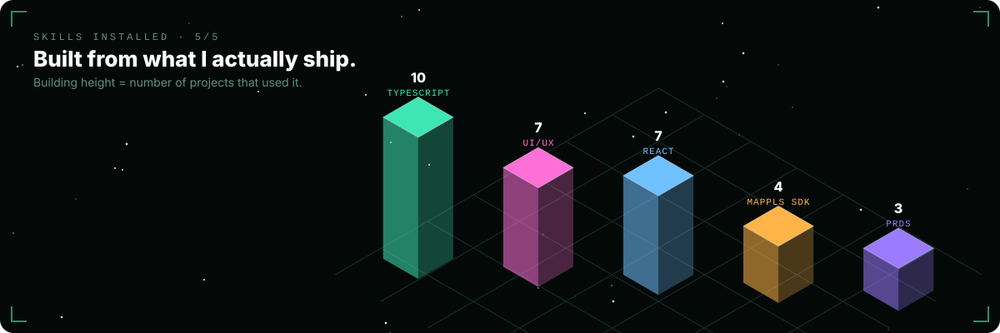

<table>
<tr>
<td width="33%" valign="top">

**📐 Product** 
PRDs · user stories · acceptance criteria · roadmaps · prioritisation · A/B testing · Agile/Scrum · stakeholder management

</td>
<td width="33%" valign="top">

**🎨 Design** 
Figma · Spline · Adobe Suite · wireframes · prototypes · UX research · usability testing · design systems

</td>
<td width="33%" valign="top">

**⚙️ Build** 
Next.js · React · Angular · React Native · TypeScript · Three.js · D3.js · Node.js · Spring Boot · AWS · AI-assisted development (Claude, Gemini, ChatGPT)

</td>
</tr>
</table>

> *"A jack of all trades is a master of none, but oftentimes better than a master of one."* That's the proverb I work by.

<table>
<tr>
<td width="33%" valign="top">

### [DumbMoney ↗](https://www.dumbmoney.in/)
FOUNDER &amp; CPO 
A coupon and deals platform for Indian online shoppers: verified codes and cashback from Indian retailers, no signup.

</td>
<td width="33%" valign="top">

### [WatchSense ↗](https://watchsensecrm.com)
BUILDING NOW 
A retail CRM for shops, clinics and salons: automatic birthday wishes, service reminders and WhatsApp offers that bring customers back.

</td>
<td width="33%" valign="top">

### [Smaak.ux ↗](https://www.behance.net/aliak8)
DESIGN STUDIO · SINCE 2023 
Brand, web and product design for 10+ clients: Sunder Masala, Wolf Casa, Lean Multiverse, Mintair, Ekal and more. See [Behance](https://www.behance.net/aliak8) and [Figma](https://www.figma.com/@aliak).

</td>
</tr>
</table>

<table>
<tr>
<td width="50%"><a href="https://github.com/aliazam1291/sapceos">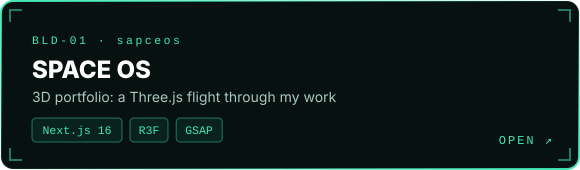</a></td>
<td width="50%"><a href="https://github.com/aliazam1291/D3-Advance-Visuals">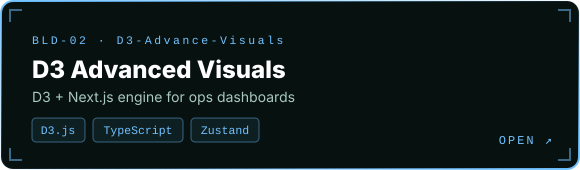</a></td>
</tr>
<tr>
<td width="50%"><a href="https://github.com/aliazam1291/sundar">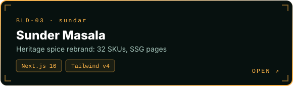</a></td>
<td width="50%"><a href="https://github.com/aliazam1291/casa">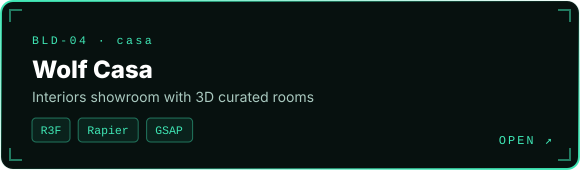</a></td>
</tr>
<tr>
<td width="50%"><a href="https://github.com/aliazam1291/react-tech-loaders">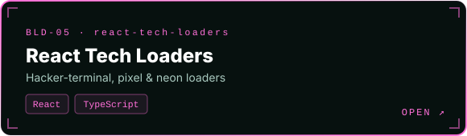</a></td>
<td width="50%"><a href="https://github.com/aliazam1291/Honeypot-ssh">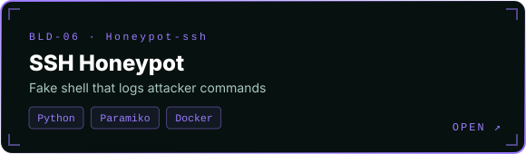</a></td>
</tr>
</table>

<b>📂 All projects, with descriptions and stacks</b>

 

| Project | Description | Stack |
|---|---|---|
| 🌌 **[SPACE OS](https://github.com/aliazam1291/sapceos)** · [live](https://aliazamkazmi.vercel.app/) | My portfolio, built as a 3D flight through a galaxy: projects are missions, case studies are drones. Before each release, Playwright harnesses check SEO, Lighthouse and mobile | Next.js 16, React 19, Three.js, R3F, GSAP, Lenis, Supabase |
| 📊 **[D3 Advanced Visuals](https://github.com/aliazam1291/D3-Advance-Visuals)** | A D3 + Next.js visualization engine for analytics and operations dashboards. Reusable, themeable chart components with a dark and a light theme | D3.js, Next.js, TypeScript, Zustand |
| 🌶️ **[Sunder Masala](https://github.com/aliazam1291/sundar)** | Rebrand website for a heritage spice brand (est. 1975): a 32-SKU catalogue in three product ranges, statically generated product pages, a regional map and the brand story | Next.js 16, Tailwind CSS v4 |
| 🛋️ **[Wolf Casa](https://github.com/aliazam1291/casa)** | Website for a premium interiors showroom with 3D curated rooms and physics-based interactions | Next.js, React Three Fiber, Rapier, GSAP, Radix UI |
| 💍 **[Happy Weddings](https://github.com/aliazam1291/Happy-weddings-hue-cycle-v2)** | Website for a wedding-planning studio: parallax storytelling, project galleries, a blog, an Instagram feed, sitemap and robots.txt | Next.js, Framer Motion, GSAP, Lenis, Radix UI |
| 🎙️ **[KU](https://github.com/aliazam1291/KU)** | Website for a talk-show and podcast community: featured shows, episodes and a hosts carousel, with a custom cursor | Next.js, TypeScript, Three.js, Framer Motion |
| ⏳ **[React Tech Loaders](https://github.com/aliazam1291/react-tech-loaders)** | Futuristic React loading screens: hacker terminal, pixel world and neon circular loaders | React, TypeScript |
| 💹 **[Crypto Dashboard](https://github.com/aliazam1291/Crypto-Dashboard)** · [Figma](https://www.figma.com/community/file/1618234851830942940/futuristic-crypto-dashboard) | A futuristic crypto-trading dashboard, from Figma design to code | React, Vite, Tailwind CSS, MUI, Radix UI |
| 🔐 **[SSH Honeypot](https://github.com/aliazam1291/Honeypot-ssh)** | A Dockerised SSH honeypot that simulates a shell and logs attacker commands | Python, Paramiko, Docker |
| 🔁 **[Telegram → Discord Bot](https://github.com/aliazam1291/Telegram-To-Discord-Forward-Bot)** | Forwards messages from Telegram channels to Discord in real time | Python, Telethon, Discord |

<b>🧠 AI / ML &amp; computer-vision projects</b>

| Project | Description |
|---|---|
| **[PUJ Obstruction Detection](https://github.com/aliazam1291/Pelvic-Uretero-Pelvic-Obstruction-Using-Deep-Learning)** | Deep learning on ultrasound images to classify pelvi-ureteric junction (PUJ) obstruction. Transfer learning with VGG16, InceptionV3 and DenseNet121; research paper included |
| **[Handwritten Text Recognition](https://github.com/aliazam1291/Dectect-handwritten-text)** | OCR pipeline with OpenCV preprocessing and Tesseract |
| **[Multilingual Text Inversion](https://github.com/aliazam1291/multi-lingual-text-inversion)** | Detects whether text in an image is upside down, across multiple scripts such as English and Greek (VGG16, contour bounding boxes) |
| **[Stock Market Prediction](https://github.com/aliazam1291/Stock-market-prediction)** | Keras stock-price prediction model served through a Flask API (Alpha Vantage data) with a React frontend |
| **[Image Augmentation](https://github.com/aliazam1291/Image-Augmentation)** | Image augmentation with imgaug to expand medical-imaging training datasets |
| **[Artificial Intelligence](https://github.com/aliazam1291/Artificial-Intelligence)** | Classic AI algorithms: BFS/DFS, CSP, graph colouring, unification, water jug, ANN, sentiment analysis |

<b>🕹️ Earlier builds</b>

[Carbon Footprint Calculator](https://github.com/aliazam1291/Carbon-footprint-calculator) · [Weather Forecast](https://github.com/aliazam1291/Weather-forcast) · [Excel Management App](https://github.com/aliazam1291/Excel-Management-Application) · [NASA Website Revamp](https://github.com/aliazam1291/Nasa-Revamp) · [Space Invaders](https://github.com/aliazam1291/Space_invasion) · [Flappy Bird](https://github.com/aliazam1291/Flappy-bird) · [LeetCode solutions](https://github.com/aliazam1291/Leetcode)

  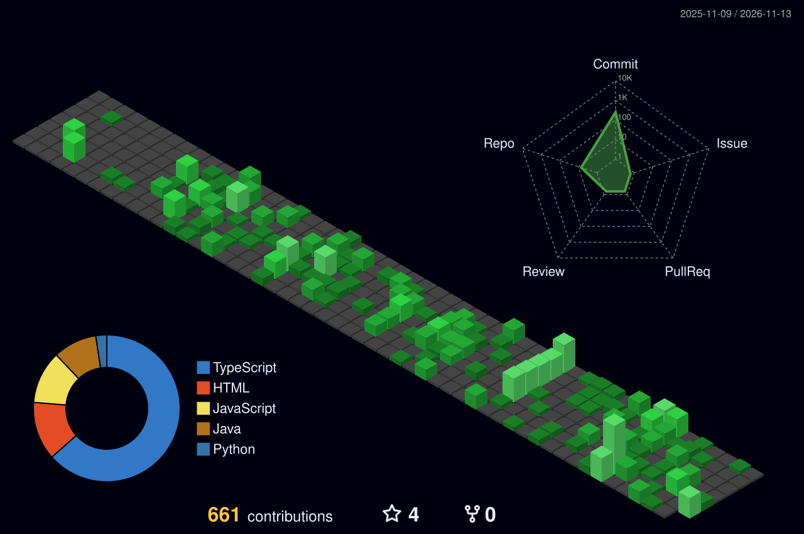

  

<picture>
  <source media="(prefers-color-scheme: dark)" srcset="https://raw.githubusercontent.com/aliazam1291/aliazam1291/output/github-contribution-grid-snake-dark.svg" />
  
</picture>

<b>⚡ Recent activity</b>

 

<!--START_SECTION:activity-->
<!--END_SECTION:activity-->

 

  <b>Coming in to land.</b> Open to Product Manager / Technical PM roles · New Delhi · open to relocate 
  <a href="https://aliazamkazmi.vercel.app/contact">Open channel</a> · <a href="https://www.linkedin.com/in/ali-azam-kazmi/">LinkedIn</a> · <a href="https://www.behance.net/aliak8">Behance</a> · <a href="https://www.figma.com/@aliak">Figma</a> · <a href="https://aliazamkazmi.vercel.app/Ali_Azam_Kazmi_.pdf">Résumé</a>

  

